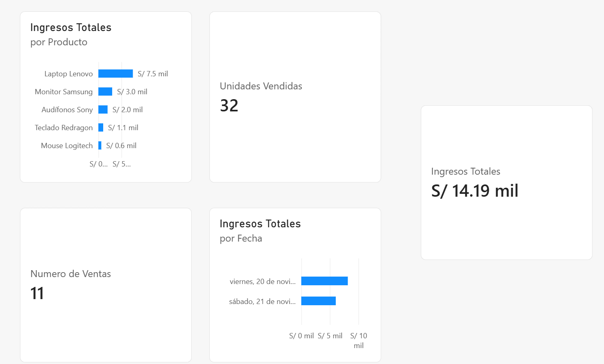

# DataStore Analytics

## Descripción del proyecto

DataStore Analytics es un proyecto de portafolio orientado al
análisis de ventas, procesamiento ETL, calidad de datos e
inteligencia de negocios.

El proyecto simula el procesamiento de información comercial
de una empresa ficticia dedicada a la venta de productos
tecnológicos.

## Objetivos

- Automatizar la lectura y validación de archivos CSV.
- Identificar y separar registros incorrectos.
- Almacenar información en SQL Server.
- Evitar la reinserción de registros idénticos de prueba.
- Analizar indicadores comerciales mediante consultas SQL.
- Visualizar los resultados mediante Power BI.

## Tecnologías utilizadas

| Tecnología | Aplicación |
|---|---|
| Python | Procesamiento ETL y validación |
| SQL Server | Almacenamiento de datos |
| T-SQL | Consultas analíticas |
| Power BI | Visualización de indicadores |
| DAX | Medidas e indicadores |
| Excel | Análisis inicial de ventas |
| pyodbc | Conexión entre Python y SQL Server |
| Visual Studio Code | Desarrollo de scripts |
| SSMS | Administración de bases de datos |

## Arquitectura del proyecto

CSV → Python ETL → SQL Server → Power BI

El proceso ETL realiza las siguientes operaciones:

1. Extracción de registros desde archivos CSV.
2. Validación de fechas, productos, cantidades y precios.
3. Separación de registros válidos y rechazados.
4. Generación de archivos CSV procesados.
5. Carga controlada de registros en SQL Server.
6. Actualización del dashboard de Power BI.

## Resultados del proyecto

| Indicador | Resultado |
|---|---:|
| Ingresos totales | S/ 14,190.00 |
| Unidades vendidas | 32 |
| Número de ventas | 11 |
| Importe promedio por venta | S/ 1,290.00 |
| Producto con mayores ingresos | Laptop Lenovo |
| Producto con más unidades vendidas | Audífonos Sony |

## Dashboard de Power BI

Visualización de los principales indicadores comerciales
obtenidos después del procesamiento ETL y la carga de datos
en SQL Server.

## Calidad de datos

Durante las pruebas del proceso ETL se evaluaron cinco registros.

- Registros procesados: 5
- Registros válidos: 2
- Registros rechazados: 3

Los registros rechazados se almacenan junto con el motivo
de rechazo para facilitar su revisión.

La carga repetida de los dos registros válidos fue comprobada
sin generar nuevas inserciones.

## Estructura del proyecto

    DataStore_Analytics/
    ├── data/
    ├── ejercicios/
    ├── powerbi/
    ├── python/
    ├── sql/
    └── README.md

## Ejercicios de aprendizaje

La carpeta `ejercicios` contiene prácticas desarrolladas
durante el aprendizaje de Python. Algunos scripts requieren
adaptar sus rutas para ejecutarse de forma independiente.

## Requisitos

- Python 3.14
- Microsoft SQL Server Express
- ODBC Driver 18 for SQL Server
- SQL Server Management Studio
- Power BI Desktop
- Biblioteca pyodbc

## Instalación y ejecución

Instalar la dependencia:

    python -m pip install pyodbc

Ejecutar los siguientes scripts SQL en SSMS:

    sql/01_crear_base_datos.sql
    sql/02_insertar_datos.sql

Desde la carpeta principal del proyecto, ejecutar:

    python python/etl_datastore.py
    python python/conexion_sql.py
    python python/verificar_duplicados.py
    python python/cargar_ventas_sql.py

Finalmente, ejecutar las consultas analíticas:

    sql/03_consultas_analiticas.sql

La conexión utiliza autenticación de Windows y una instancia
local de SQL Server Express.

## Limitaciones

Este proyecto utiliza datos ficticios con fines educativos.

La detección de duplicados se basa en la coincidencia de los
campos de una venta. En un entorno empresarial se recomienda
utilizar identificadores únicos de transacción.

La configuración del certificado SQL Server corresponde
a un entorno local de desarrollo, no de producción.

## Competencias desarrolladas

- Análisis de datos.
- Consultas T-SQL.
- Procesamiento ETL.
- Validación y calidad de datos.
- Manejo de excepciones en Python.
- Integración con bases de datos.
- Visualización de datos.
- Inteligencia de negocios.

## Autor

**Angel Pastor Nuñez** 

Estudiante de Ingeniería de Sistemas
Universidad César Vallejo.

Proyecto personal de aprendizaje y portafolio profesional.

2026
